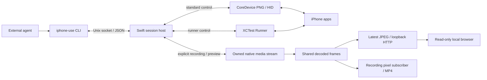

# Architecture and repository layout

iPhone-use provides observations and actions for an external agent operating a physical iPhone. The calling agent owns task planning, image interpretation, and judging outcomes. iPhone-use owns device access, reference validity, execution facts, and session cleanup.

The current source supports explicit [standard and runner modes](control-modes.md). Standard uses the [Apple native backend](apple-native-backend.md) for CoreDevice screenshots and HID; runner uses XCTest. Both can own a native media connection for recording and experimental local preview. An active session never switches its control backend automatically.

## Runtime components



The CLI and host are two process roles of the same executable. A connection starts a host for that session and the selected control backend; runner mode launches the already-installed XCTest app with CoreDevice `--no-activate` and connects to its loopback listener through usbmuxd (USB only). Subsequent CLI calls reuse the host and its control connection. The diagram shows the shared recording path when preview is already active; recording without preview retains its independent decoder.

| Component | Owns |
| --- | --- |
| [CLI](../Sources/IPhoneUse/IPhoneUse.swift) | Argument parsing, command dispatch, text/JSON output, and exit codes. |
| [Session client](../Sources/IPhoneUseCore/Session/Client/SessionClient.swift) | Host startup, local IPC, response matching, and transport uncertainty. |
| [Session host](../Sources/IPhoneUseCore/Session/Host/SessionHost.swift) | Serial request execution, device ownership, observation references, outcome classification, and lifecycle coordination. |
| [Observation cache](../Sources/IPhoneUseCore/Observation/Observation.swift) | AX compaction, cached snapshots, queries, pagination, and reference invalidation. |
| [XCTest backend](../Sources/IPhoneUseCore/Backends/XCTest/XCTestBackend.swift) | Standalone Runner process ownership, capability checks, USB loopback transport, and backend cleanup. |
| [Device discovery](../Sources/IPhoneUseCore/Device/DeviceDiscovery.swift) | Device metadata, installed-app queries, and native-tool diagnostics. |
| [Runner setup](../Sources/IPhoneUseCore/Setup/RunnerSetup.swift) / [source build](../Sources/IPhoneUseCore/Setup/RunnerBuild.swift) | Preparing a packaged Runner with local signing, or building a signed Runner from source. |
| [iOS Runner](../Runner/LiveSessionTests.swift) | Screenshots, AX collection, app activation, input primitives, device-side checks, and execution facts. |

The Runner does not own agent-facing observation IDs, short references, snapshot caches, or task strategy. It receives resolved targets or coordinates from the host. Tap/swipe use screen-context and fingerprint checks; type/press use AX target checks. The host interprets returned execution facts as `completed`, `not_dispatched`, or `unknown`.

The host and native Xcode project depend on the local static Swift package [IPhoneUseRunnerSupport](../packages/runner-support/Package.swift). It contains shared AX identity/path algorithms, text transactions, geometry, image comparison and bounded validation. It imports neither XCTest nor `IPhoneUseCore`/`AppleNativeBridge`; actual XCTest element access and Objective-C adapters remain in `Runner/`. The Runner links the package product instead of compiling individual Core source paths. Static linkage adds no embedded framework or runtime resource bundle. The production build does not depend on local experiments, an installed test Fixture app, or XcodeGen.

## Session lifecycle

1. `connect` resolves the device, acquires its lock within the state directory, starts the backend, and returns a session ID after readiness checks.
2. Independent CLI processes send requests through the session's Unix socket. Device requests run serially; the host retains observations between calls.
3. Starting a new observation invalidates previous references. The cache keeps the latest two successful observations; `inspect` can read a retained snapshot without making its references current again.
4. Before a device action, the host resolves the reference and marks existing references pending. Completion, an unknown outcome, or a detected target change invalidates them. A confirmed pre-dispatch rejection can preserve them when no other invalidation occurred.
5. `disconnect` stops admission, finishes accepted work, and releases the session's resources. Idle expiry follows the same cleanup path. Socket and observation files are removed; diagnostic files may remain.

The idle timeout defaults to 30 minutes and accepts `s`, `m`, or `h` units through `connect --idle-timeout`. Successful `apps`, `observe`, and `inspect` renew it when they finish. Valid `open` and locally resolved action requests also renew it, including unknown outcomes. Argument/reference failures do not renew it. `status` checks health without renewing the timeout. Accepted, queued, or running requests are protected from idle cleanup.

The host does not automatically replay unknown actions or restore old references after restarting. See [observations](observations.md), [actions](actions.md), and [screen guards](screen-guard.md) for detailed contracts.

The CLI's optional action `--observe` composes two existing host requests and returns their responses separately. It needs no new host or Runner protocol and does not reserve the serial queue between requests. Observation failure cannot overwrite action facts, and neither operation is replayed. See the [combined response contract](actions.md#动作后观察).

## Shared native preview and recording

An explicit `preview` request starts a read-only HTTP listener on loopback and acquires the session-owned media stream if needed. Control stays on HID or XCTest. A recording started while preview is active subscribes to the same decoded pixels, rather than restarting the stream; stopping one consumer retains media for the other. Disconnect and idle expiry clean up both. Browser HTTP requests do not renew the session or produce observations.

`NativePreview` keeps only the latest JPEG and uses two bounded CPU conversion slots; superseded results are discarded. The source target is 30 fps, a 960-pixel longest edge and JPEG quality 0.7. Receiver and snapshot decode queues use `userInitiated` QoS, with separate queue-wait/decode and conversion/compression timing. When preview already has a decoded frame, the host prepares the encoder before subscribing and starts the recording clock after preparation. This prevents cold encoder setup from filling the bounded pixel queue; it does not enlarge the queue or discard admitted frames. The recording writer releases encoder resources before complete file validation. Resource pressure can still cause stalls or recording backpressure; stable 30 fps has not passed acceptance.

Periodic orientation checks use system metadata and low-frequency PNG negative evidence. They do not supply action pixels or coordinates. Rotation ends the current recording segment and rebinds preview after owned-stream cleanup; recovery can be delayed. The experimental CPU orientation-probe change was reverted; the probe retains its default CIContext. See [local preview](local-preview-prototype.md) for the current implementation, lifecycle, usage and limitations, and [acceptance history](local-preview-validation.md) for version-specific evidence.

## Repository layout

```text
iPhone-use/
├── .agents/plugins/                 # Codex Git marketplace
├── .claude-plugin/                  # Claude Code Git marketplace
├── .github/workflows/               # CI and release workflows
├── Package.swift                    # Executable, core library, and test resources
├── Package.resolved                 # Pinned Swift dependency resolution
├── Sources/
│   ├── IPhoneUse/                   # CLI entry point
│   ├── AppleNativeBridge/          # macOS Objective-C runtime adapters
│   └── IPhoneUseCore/
│       ├── Session/                # Client, host, lifecycle and session storage
│       ├── Actions/                # Validated actions and input requests
│       ├── Observation/            # Complete AX cache, references and presentation
│       ├── Backends/               # Shared contract; AppleNative and XCTest adapters
│       ├── Media/                  # Streaming, decoding, recording and preview
│       ├── Device/                 # Discovery, display metadata and device locks
│       ├── Transport/              # IPC, USB and Apple service transports
│       ├── Setup/                  # Runner build, signing and installation preparation
│       ├── Configuration/          # Mode, preview and timeout configuration
│       ├── Output/                 # Agent-facing formatting
│       └── Utilities/              # JSON and error helpers
├── packages/runner-support/         # macOS/iOS static package; no host/runtime dependencies
│   ├── Sources/IPhoneUseRunnerSupport/
│   └── Tests/IPhoneUseRunnerSupportTests/
├── Runner/
│   ├── IPhoneUseRunner.xcodeproj/   # Shared project and scheme
│   └── LiveSessionTests.swift       # Device-side Runner
├── Tests/IPhoneUseCoreTests/
│   ├── Fixtures/Observations/       # Sanitized AX regression data
│   ├── Support/                    # Synthetic image/network helpers
│   └── <responsibility>/          # Mirrors Core responsibilities, in one test target
├── docs/
│   ├── examples/observe/            # Curated CLI output example
│   └── *.md                        # Public guides and architecture
├── scripts/                         # Release/plugin tooling and tests
├── skills/iphone-use/                # Canonical skill, client adapters and preflight
├── plugins/iphone-use/               # Generated self-contained dual-client plugin
├── packaging/homebrew-tap/          # Tap setup and update workflow
├── README.md                        # Default English entry point
├── README.zh-CN.md                  # Chinese entry point
└── LICENSE
```

Commit files needed to build, test, distribute, or understand the public project. Keep the Swift lockfile, shared Xcode project/scheme, release scripts, and sanitized test fixtures in Git. Xcode user settings are local; do not ignore all `.xcodeproj` files.

The plugin contains instructions and a preflight script; it does not add another runtime service. Edit `skills/iphone-use/`, then run `python3 scripts/sync-plugin.py` to update the committed distribution. CI rejects drift. The [public website](https://iphone-use.com) is maintained in the separate [iphone-use-website](https://github.com/HughLee824/iphone-use-website) repository and deployed through Cloudflare Workers Static Assets at `iphone-use.com`. The public client installation path is documented in [public access release](public-access-release.md).

Test inputs belong under `Tests/IPhoneUseCoreTests/Fixtures` and are loaded through SwiftPM's resource bundle. Tests must pass in a fresh checkout without `spikes/`, private device captures, or files under `docs/examples`. Published examples should illustrate the current interface, use placeholder paths and IDs, and identify any omitted media.

## Engineering checks

Run `python3 scripts/check.py` from a full-Xcode macOS environment with SwiftLint and Node.js 22+. Local development, CI and draft releases use this same device-free entry point. It runs strict lint, builds the CLI, runs the independent shared-package and Core Swift tests plus Objective-C runtime doubles, supplies the built CLI path to Python integration tests, runs all Node test files, builds the unsigned iOS Runner, and checks/packages the plugin. A missing CLI is an error in this full check, rather than a silently skipped integration suite. Build concurrency defaults to two jobs (`--jobs` can override it).

Core directory grouping does not introduce additional Swift module boundaries. The shared package is the one extracted module: dependencies run from Core and Runner to it, never back to either consumer. Its public declarations are the repository-internal cross-module contract, not a separately versioned SDK. Keep type extensions together and assign files by responsibility, not by `Native`/`Runner` prefixes. `SessionBackend` belongs to both adapters; media implementation is shared by both modes. Resource fixtures remain at the Core test target root and load through `Bundle.module`. AX/path, transaction and XCTest-default tests run independently in the shared package; tests that exercise host serialization, observations or native capture remain in Core. Root `swift test` does not run dependency-package tests; `scripts/check.py` runs both suites explicitly.

The retired XCTest attachment recording experiment was removed; its findings remain in [Runner recording](runner-recording.md). The ordinary `NativeTextProbe` App and current acceptance tools remain available for physical-device validation. Device tests are explicit and are not part of the automated check entry point.

## Local-only files

The [.gitignore](../.gitignore) separates local development material from the public tree:

| Local material | Location or pattern |
| --- | --- |
| Swift/Xcode build output | `.build/`, `.swiftpm/`, `build/`, `DerivedData/`, `*.xcresult/`, `*.xcarchive/`, `*.dSYM/`, `*.ipa` |
| Personal notes and working copies | `.local/`, `alignment.md`, `docs/analysis/` |
| Early device experiments and evidence | `spikes/` |
| Retired design discussions | `docs/agent-interface.md`, `docs/cli-vs-mcp.md`, `docs/session-host.md`, `docs/v0.1-plan.md` |
| Original observation drafts and captures | The retired sample paths explicitly listed in `.gitignore`; curated output stays public. |
| Machine settings and caches | `.DS_Store`, `xcuserdata/`, `*.xcuserstate`, `__pycache__/`, Python bytecode, `*.log` |
| Signing and environment files | `*.mobileprovision`, `*.provisionprofile`, `*.p12`, `*.pfx`, `*.p8`, `.env*` except `.env.example` and `.env.*.example` |

New private notes and device records should go under `.local/`. Original development files can remain at their ignored paths for local use. Share only intentionally curated, sanitized excerpts; do not add broad exceptions for raw evidence directories.

Ignore rules do not remove files already tracked by Git. Use `git rm --cached` for a file that should remain on disk but leave the repository, and commit that change. An ordinary removal affects later commits; earlier commits still contain their original contents.

## Runtime storage

Session files default to `/private/tmp/iphone-use-<uid>`; `IPHONE_USE_STATE_DIR` can choose a different, short path. Directory permissions are `0700`. Every host holds a device lock in the default root plus its selected state directory when different, preventing concurrent device ownership across custom roots. Locks are released when their holder exits.

Packaged Runner preparation is stored in `~/Library/Application Support/iphone-use`, separate from the source checkout and install directory. It contains locally re-signed artifacts and the user's provisioning profile. Private keys remain in Keychain. The device token stays in host memory and the XCTest subprocess environment rather than configuration files or CLI output.

See [installation](install.md), [onboarding](onboarding.md), and [release tooling](release-setup.md) for setup, renewal, and distribution.


### Runner 路径定位与完整 AX 采集

`observationVersion=4` 通过 `snapshotWithParameters:error:` 显式请求 `snapshotKeyHonorModalViews=false` 的标准属性快照，不读取查询对象缓存的根快照。每次观察和动作校验都重新请求。导出不再固定截断为 200 个节点；宿主保存返回树的全部节点，展示仍受 60 行 / 8 KiB 预算约束，`inspect` 在缓存上查询和分页。既有传输大小与时间限制继续生效，超限明确失败，不静默返回部分树。App 未向 XCTest 暴露的节点无法凭此补齐；非模态采集也不代表所有节点可操作，执行前仍检查上下文、enabled 和 hittable。

`actionVersion=12` 的 type/press 从最新原始快照根节点沿观察时保存的完整 `childIndex` 路径逐级校验类型、identifier、label、value、enabled、frame 和 AX 身份。观察时每个节点产生随机 `identityToken`，Runner 保留 token 对应的 AX 身份，仅用于比较；新观察、动作消费使旧引用失效。命中节点后，通过 `RunnerAXBinding` 绑定该快照的 AX 身份。随后检查绑定元素的身份与属性，再重新采集根快照、复核整条路径和目标身份。没有全 App 的 type/identifier/label 模糊重查，也不假定 `XCUIElement.children` 查询的顺序等于原始快照子节点顺序。坐标手势保持现有像素 guard 路径，不使用此文本目标解析器。

绑定封装使用 XCTest 运行时的 `accessibilityElement` 和 `_elementMatchingAccessibilityElementOfSnapshot:`，调用前检查方法签名，捕获异常；接口缺失或绑定结果类型不符时返回 `target_binding_unavailable`，不降级为按名称或索引猜测。CLI 与 Runner 必须同时更新，不兼容版本在连接时拒绝。

路径是结构地址而非永久对象身份。观察时保留的 AX 身份可以拒绝同地址、同属性但 AX 身份不同的替换；不宣称能识别平台自身复用的身份，也不能消除最后一次校验与事件发送之间的竞态。

文本操作使用 `hasKeyboardFocus` 判断绑定元素是否已获键盘焦点，不使用表示 UI 焦点的 `hasFocus`。需要聚焦时只点击一次，随后重新采集和校验路径、身份及键盘焦点。定位光标后、清空后、插入前和插入后均重新验证；自身修改文本后仅允许叶节点 label/value 内容变化。焦点切换创建了新控件时停止，要求新观察，不能迁移旧命令。替换/追加还验证清空结果和最终完整值。`textExecution` 回执记录阶段、聚焦、键盘事件尝试次数和插入确认；部分执行或结果不确定时不重放。运行时接口不可用时明确失败，不退回按名字或位置猜测。以上逻辑不含 App 名称、bundle ID 或特定页面分支。

自身聚焦、定位、清空、插入之后，事务内允许仅几何差异的有界只读收敛：每阶段最多 5 秒、6 次完整解析，间隔最多 100 ms。先完成全路径身份及非几何属性、绑定和最新根复核，再分类几何差异；身份/路径错误不会被移动的祖先掩盖。每次重新采集，最终仍要求原 frame 的 0.5 pt 容差，返回最新根中的叶快照。超时为 `text_geometry_unsettled`，不重放输入。回执记录累计读取/几何重查次数、超时和最近阶段耗时；Apple 同步调用不能被期限硬中断。实现与三类真机验收见 [输入事务收敛验证](runner-text-convergence-verification.md)。
